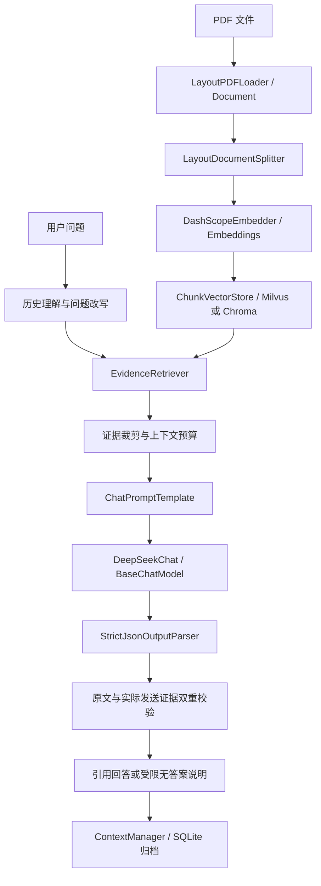

# MiniRAGFlow

一个基于 LangChain 组件与 LCEL 链的 Python RAG 项目，支持 PDF 解析、向量检索、带来源问答和多轮上下文管理。
使用 DashScope `text-embedding-v2` 向量化、Milvus / Chroma 存储，以及 DeepSeek 生成经校验的原文回答。

## 功能与结构

- PDF 文本与表格解析，保留页码、类型和坐标；正文按句子边界切分，标题和表格保持完整。
- Milvus 云端与 Chroma 本地存储，支持重复导入更新、来源过滤和余弦检索。
- 终端交互与单次问答，逐条校验原文摘录和引用来源。
- 分级上下文压缩、SQLite / gzip 历史归档和同一会话的相关历史恢复。
- CRUD-RAG 固定子集检索评测，以及无需真实 API 的回归测试。

| 目录 | 职责 |
| --- | --- |
| `document/` | PDF、表格、布局解析和切片 |
| `embedding/`、`vectorstore/` | 向量化和存储后端 |
| `RAG/`、`llm/` | 入库、检索问答和模型客户端 |
| `context_management/` | 上下文预算、压缩和历史归档 |
| `evaluation/`、`tests/` | 检索评测和回归验证 |

解析与存储说明见 [document/README.md](document/README.md) 和
[embedding/README.md](embedding/README.md)；评测结果与复现方法见
[evaluation/README.md](evaluation/README.md)。

## LangChain 架构

主流程使用 `langchain-core` 的标准接口；底层布局解析、HTTP 协议和数据库集合格式
保留项目自己的实现。无需迁移现有 Milvus / Chroma 数据，也无需重新入库；已有
`main.py` 命令和 `.env` 配置继续使用。



| 实现 | LangChain 接口 / 职责 |
| --- | --- |
| `document/langchain.py` | `BaseLoader` 输出 `Document`；`BaseDocumentTransformer` 保留布局进行切片 |
| `embedding/embed.py` | `Embeddings`，文档和查询分别使用 DashScope 的 document / query 类型 |
| `vectorstore/langchain.py` | `VectorStore` 适配旧集合；`BaseRetriever` 筛选有来源的合格证据 |
| `llm/chat.py` | `BaseChatModel`，支持 `invoke`，保留 JSON 模式、模型预算和完整响应检查 |
| `llm/chains.py` | `ChatPromptTemplate → 聊天模型 → StrictJsonOutputParser` |
| `RAG/pipeline.py` | LCEL 入库链，先完成全部向量化再连接数据库写入 |
| `RAG/qa.py` | LCEL 问答链，使用 `RunnableBranch` 分流，回答通过校验后才归档 |

提示词通过模板变量传入，JSON 示例不会被误识别成占位符。JSON 解析不修复截断内容、
不接受 Markdown 代码块；网络错误继续抛出。历史恢复和分级压缩由 `ContextManager`
负责，并在每次模型请求前执行；历史仍不能充当本轮知识库证据。

Python 中可直接组合组件：

```python
from document.langchain import LayoutPDFLoader, LayoutDocumentSplitter
from RAG.pipeline import create_indexing_chain

# 只解析和切片，不调用模型或写入数据库
documents = LayoutPDFLoader("data/test.pdf").load()
chunks = LayoutDocumentSplitter(chunk_size=300, chunk_overlap=50).split_documents(documents)
print(chunks[0].page_content, chunks[0].metadata)

# 执行入库链；也可继续使用 index_pdf("data/test.pdf")
ids = create_indexing_chain(backend="chroma").invoke("data/test.pdf")
```

```python
from embedding.embed import DashScopeEmbedder
from llm.chat import DeepSeekChat
from RAG.qa import QASettings, RAGQuestionAnswerer
from vectorstore.factory import create_vector_store

embedder = DashScopeEmbedder()
store = create_vector_store(embedding_model=embedder.embedding_id, backend="chroma")
try:
    qa = RAGQuestionAnswerer(embedder=embedder, store=store, chat=DeepSeekChat(), settings=QASettings())
    answer = qa.invoke("文档中描述了哪些功能？", config={"tags": ["local-rag"]})
    # qa.ask(...) 兼容旧接口；qa.chain 是可组合的 LangChain Runnable。
    print(answer)
finally:
    if hasattr(store, "close"):
        store.close()
```

`invoke(..., config=...)` 支持 LangChain 的 callbacks 和 tags。
同一个带 `ContextManager` 的问答实例应顺序调用，保证历史归档顺序。
`DeepSeekChat` 专用于完整 JSON 响应，不实现工具调用或增量生成。

`ChunkVectorStore.add_documents` 每次接收**同一来源的完整片段**，写入后会清理该来源
旧的多余片段；不能用它向同一来源逐个追加 chunk。写入必需元数据为 `source` 和
正整数 `page_number`，布局字段可选；持久化字段与现有集合一致。
`EvidenceRetriever.min_similarity` 使用原始余弦分数，与 `RAG_MIN_SIMILARITY` 一致。
标准 `similarity_search_with_score` 返回 `1-cosine` 距离；
`similarity_search_with_relevance_scores` 返回 `(cosine+1)/2`，范围为 0 到 1；
使用标准 `as_retriever` 的 relevance 阈值时需采用后一尺度。

接口定义参见 [LangChain 核心组件参考](https://reference.langchain.com/python/langchain-core/langchain_core)。

## 配置与运行

需要 Python 3.11 或更高版本。在项目根目录执行：

```powershell
python -m venv .venv
.\.venv\Scripts\python.exe -m pip install -r requirements.txt
if (-not (Test-Path .env)) { Copy-Item .env.example .env }
```

如果没有 `.env`，将 `.env.example` 复制为 `.env`，填入自己的凭证。
已有 `.env` 时请保留原配置，只添加缺失的字段，不覆盖现有凭证。

| 配置项 | 用途 / 默认值 |
| --- | --- |
| `DEEPSEEK_API_KEY` | DeepSeek API 密钥，必填 |
| `DEEPSEEK_BASE_URL` | `https://api.deepseek.com`，也支持末尾 `/v1` |
| `DEEPSEEK_MODEL` | `deepseek-flash` |
| `DEEPSEEK_TIMEOUT` | 请求超时，默认 60 秒 |
| `DEEPSEEK_CONTEXT_WINDOW` | 留空按模型识别；自定义模型填写真实上下文 token 上限 |
| `CONTEXT_ARCHIVE_DIR` | 本地打包历史目录，默认 `data/context` |
| `CONTEXT_RECENT_TURNS` | 压缩时优先保留最近对话轮数，默认 6 |
| `CONTEXT_RECALL_TOP_K` | 每次从本地历史恢复的相关轮数，默认 3 |
| `CONTEXT_SESSION_ID` | 留空每次新建会话，或指定 ID 恢复同一会话 |
| `DASHSCOPE_API_KEY` | 与入库时相同的 DashScope 密钥，必填 |
| `DASHSCOPE_API_HOST` | 与入库时相同的向量服务地址 |
| `VECTOR_STORE` | `milvus` 或 `chroma`，默认 `milvus` |
| `MILVUS_URI` / `MILVUS_TOKEN` | Milvus 云端 Endpoint 和凭证 |
| `MILVUS_COLLECTION` | 已入库的集合名称，默认 `miniragflow_chunks` |
| `RAG_TOP_K` | 每次检索片段数，默认 5 |
| `RAG_MIN_SIMILARITY` | 最低余弦相似度，默认 0.65，不是回答置信度 |
| `RAG_MAX_CONTEXT_CHARS` | 发送给 DeepSeek 的原文字符上限，默认 12000 |
| `RAG_COLLECTION` | 问答专用集合；留空使用后端默认集合，不影响管理命令 |

```powershell
# 检查已有知识库
.\.venv\Scripts\python.exe main.py --check

# 知识库为空时，显式导入 PDF
.\.venv\Scripts\python.exe main.py --index --pdf data/test.pdf

# 启动交互问答，exit / quit / 退出 或 Ctrl+C 结束
.\.venv\Scripts\python.exe main.py

# 使用固定会话，重启后继续之前的对话
.\.venv\Scripts\python.exe main.py --session work1

# 单次问答，无依据时由 AI 生成无答案说明
.\.venv\Scripts\python.exe main.py --ask "文档中描述了哪些功能？"

# 保留原有原文检索命令（用于调试，不是 AI 问答）
.\.venv\Scripts\python.exe main.py --query "文档中描述了哪些功能？"
```

激活虚拟环境后，也可直接运行 `python main.py`。本地 Chroma 问答读取项目的
`data/chroma`、`documents` 集合，建议在项目根目录执行入库和调试命令。
客户端不会自动导入 PDF；知识库无匹配片段时，调用 DeepSeek 生成无答案说明。
先使用自己的凭证和 `--index` 建立知识库，再运行问答。
`MILVUS_COLLECTION` 用于 PDF 入库和管理命令；`RAG_COLLECTION` 留空时读取同一集合，
也可设为自己已建立的其他集合。
`--check` 检查的是管理命令默认集合，可能与 `RAG_COLLECTION` 不同。
使用 `--backend chroma` 时，需要将 `RAG_COLLECTION` 留空或设为本地已存在的集合名称。

## 回答的约束

1. 每个问题重新检索知识库，只使用达到相似度阈值且有来源和页码的片段。
2. DeepSeek 判断资料是否能直接、完整回答问题，只返回 JSON 格式的原文摘录。
3. 程序检查每条摘录确实是对应检索原文的连续子串，并使用数据库的来源、页码标注。
   CRUD-RAG 新闻数据的编号显示为文档序号，PDF 数据显示为页码。
4. 无匹配或资料不足时，调用 DeepSeek 生成简短的无答案说明。
   原文回答出现无效 JSON、截断、虚构引用或非原文内容时，丢弃整个原文回答，
   同样调用无答案回复流程，不显示未通过校验的内容。
   AI 从受限的说明和建议原句中组合回复，程序逐句验证，禁止补充知识库之外的答案。
   无答案回复调用失败或格式不合规时，使用默认无答案说明。
5. 收到完整结果并验证后才输出，不流式展示尚未校验的内容。

为确保输出文本确实来自知识库，采用**原文摘录式回答**，不允许自由改写或补充。
资料是否相关、是否完整回答问题仍由模型判断；相似度阈值也需要针对知识库调校。
子串校验保证文本来源，不能证明知识库本身正确，也不能完全排除模型误选原文或断章取义。
现在支持多轮历史：结合历史改写追问后，重新检索知识库。
历史、摘要及本地恢复的对话只用于理解问题，不能代替本轮 RAG 原文作为答案依据。

## 分级上下文管理

独立的 `context_management/` 包负责模型容量、请求预算、压缩和本地历史恢复。
`deepseek-flash` 默认上限为 **1,048,576 tokens**（输入与输出合计），
来源为 [DeepSeek 官方模型接口](https://api-docs.deepseek.com/api/list-models/)。
自定义模型或服务的容量可能不同，应通过 `DEEPSEEK_CONTEXT_WINDOW` 填写实际上限。
未识别的模型必须显式配置，不沿用另一个模型的容量。

| 压缩前占用上限的比例 | 级别 | 压缩后整个请求的目标 |
| --- | --- | --- |
| 小于 30% | 无压缩 | 保留当前活动历史 |
| 达到 30% | 轻度 | 不超过上限的 25% |
| 达到 50% | 中度 | 不超过上限的 35% |
| 达到 70% | 强度 | 不超过上限的 40% |
| 达到 90% | 高强度 | 不超过上限的 45% |
| 达到或超过 100% | 溢出恢复 | 检索本地打包历史，再压到上限的 50% 以内 |

目标比例计算包括系统指令、当前问题、RAG 片段、对话摘要、最近历史、
本地恢复片段、JSON/消息封装，以及默认 2048 tokens 的输出预留。
每次模型请求前执行检查；如果固定指令与输出预留本身就超过目标容量，则报错而不发送。
压缩级别在同一会话内不倒退，避免强压缩后又重复执行轻度压缩。

原始问答每轮使用 **gzip 压缩包**存入 `data/context/history.sqlite3`，
与活动会话状态在同一事务保存；原文不会被活动摘要覆盖。
当前问题和检索证据本身过长时，也会先归档原始载荷，再压缩可变文本。
本地 FTS5 索引支持英文关键词与中文二字组合检索，只读取当前会话的历史。
恢复片段最多占上限的 10%，然后参与整个请求的统一预算。

文本压缩使用本地原文抽取，优先保留相关句子、首尾内容和最近对话，
不调用模型编写摘要，不新增事实。压缩可能省略细节，原始内容仍可从本地包恢复。
当前没有加载官方模型 tokenizer：使用 **UTF-8 字节数的保守 token 估计**，
计入封装与输出预留，倾向提前压缩；上述占用比例不是精确的服务端 token 使用率。

启动时显示会话 ID。用 `--session ID` 或 `CONTEXT_SESSION_ID` 恢复同一会话，
在交互中输入 `/context` 查看预算估计、最近请求压缩级别和本地归档轮数。
默认每次启动创建独立会话，不把不同会话的历史混入当前请求；同一会话应由一个客户端使用。
本地默认历史目录已加入 `.gitignore`。

交互模式的提示与回答统一写入 `stdout`，避免 IDE 中不同输出流造成显示顺序错乱。
每轮回答只显示一个 `AI：` 前缀，多个原文段落合并为一条回答，来源在末尾统一列出并去重。
无依据时也显示 `AI：`，例如：
“当前知识库检索结果中未找到这个问题的答案。请补充相关资料后再提问。”
运行错误写入 `stderr`。检索或原文问答请求失败会报错，不误报知识库没有答案。
`--ask` 的 `stdout` 是带 `AI：` 前缀的原文回答或无答案说明。
`--ask` 无依据时正常退出；检索、原文问答网络或配置错误退出码为 1。
`--query`、`--check`、`--index` 是管理命令，会正常输出原文或状态信息。
模型请求使用 [Chat Completions JSON Output](https://api-docs.deepseek.com/api/create-chat-completion/)，
问题改写和原文问答会发送当前会话的压缩历史及相关本地恢复片段；
原文问答还会发送问题和筛选后的知识库片段。无答案说明只发送问题与候选说明，
不发送数据库或向量服务凭证。

## 验证

```powershell
.\.venv\Scripts\python.exe -m unittest discover -s tests -v
```

测试使用模拟 API，不消耗真实模型额度；覆盖 AI 无答案说明、伪造内容拦截、
真实原文输出、请求异常、交互退出，以及既有入库和检索功能。
LangChain 集成测试还覆盖原生聊天模型和回调、LCEL 分支、实际 PDF 加载、
既有集合适配、两种分数尺度和同来源更新。
上下文测试另外覆盖所有压缩级别、溢出恢复到 50%、原文打包完整性、会话隔离与恢复、
追问改写、历史不能代替 RAG 证据，以及未发送片段引用拦截。
本地 CRUD-RAG 子集检查需要先生成评测数据；尚未生成时只跳过这一项检查。
真实凭据、本地会话、向量库、上游数据和完整评测输出均由 `.gitignore` 排除。
